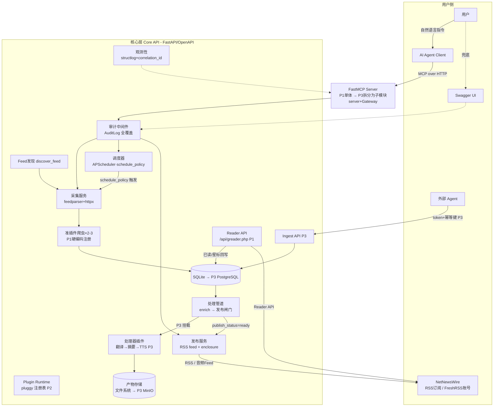

# 个人信息流系统 — 需求与架构设计 v0.6

> 单用户优先、AI-Agent-First 的 RSS+ 系统。核心组件通过 API 对接，控制平面经 MCP 暴露给 agent，agent 在用户指令下操作系统。采集与处理均插件化。
>
> **v0.6 变更**：正式采用 Nix 构建可复现开发环境与 CI 基座；新增 §10「开发环境、CI 与供应链纪律」，原部署与术语表顺延。原则：**Nix Flake 管系统依赖与工具链，uv 管 Python 依赖图；justfile 是人和 agent 的唯一命令入口。**

## 1. 需求定义

### 1.1 功能需求

#### A. 数据获取（Acquisition）

| 编号 | 需求 | 说明 |
|---|---|---|
| A1 | 被动采集 - RSS 源 | 解析标准 RSS/Atom 源，增量抓取；尊重 ETag/Last-Modified |
| A2 | 被动采集 - 爬虫插件 | 针对一类网页结构编写爬虫。P1 为准插件（遵循接口、硬编码注册），P2 固化为可导入/启用/禁用/版本管理的完整插件系统 |
| A3 | 主动数据接入 | agent 在用户指令下通过 ingest API 写入数据（独立 token、schema 校验、幂等键） |
| A4 | 调度策略 | 每源一条 `schedule_policy`：fixed（用户设定间隔）或 adaptive（按历史更新间隔自动调节 + 失败指数退避）。两者结合 = 按源分别配置 + adaptive 参数约束，非独立模式 |
| A5 | Feed 自动发现 | 给定网站 URL，解析 `<link rel="alternate">` 等返回候选 feed 列表 |
| A6 | OPML 导入导出 | 订阅列表批量迁移 |

#### B. 数据存储与处理（Storage & Processing）

| 编号 | 需求 | 说明 |
|---|---|---|
| B1 | 分层存储 | 原始层 / 规范化层；大产物存文件系统，DB 只存引用 |
| B2 | 关系建模 | source → item 血缘；content_hash 去重；标签 |
| B3 | 处理管道 | 阶段化 pipeline，幂等、可重放 |
| B4 | 处理插件接口 | enrich / pre_publish 挂载点，支持翻译、TTS、摘要等处理器；产物独立存储 |
| B5 | 错误分类法 | JobRun 强制五类错误归类：network / parse / structure_changed / blocked / auth。代码中 enum 单一来源，DB/API/文档同源生成 |

#### C. 数据提供（Delivery）

| 编号 | 需求 | 说明 |
|---|---|---|
| C1 | RSS 输出 | 标准 RSS feed，可配置过滤，稳定 GUID |
| C2 | 查询 API | 面向 agent 的紧凑查询；大内容走 Resource/ID 引用 |
| C3 | 富媒体输出 | TTS 音频等产物以 RSS enclosure 输出 |
| C4 | Reader API | Google Reader API 兼容端点（`/api/greader.php`，FreshRSS 协议），NNW 以 FreshRSS 账号登录，已读/星标多端同步 |
| C5 | 发布闸门 | Item 带 `publish_status`；挂载处理链的条目 enrich 完成前不发布——防 NNW 缓存原文导致译文永不显示 |

#### D. Agent 操作面（Control Plane）

| 编号 | 需求 | 说明 |
|---|---|---|
| D1 | 调试定位 | 诊断采集失败、插件异常、输出异常；依赖 B5 错误分类 |
| D2 | 监控快照 | 紧凑系统状态摘要，对话式 dashboard |
| D3 | 调度管理 | 查看/创建/暂停/触发/dry-run；修改源的 schedule_policy |
| D4 | 输入输出配置 | 增删源（前置 A5 发现）、修改 feed 配置 |
| D5 | 插件管理 | 列出/导入/启用/禁用/测试插件（P2 起） |
| D6 | 写操作确认 | 变更类操作经 MCP elicitation 由用户确认，server 侧执行 |

#### E. 插件系统（Plugin System）

| 编号 | 需求 | 说明 |
|---|---|---|
| E1 | 两类插件 | CollectorPlugin（**5 个已注册**，rss 内置、其余第三方（ADR 0017））、ProcessorPlugin（P3） |
| E2 | 声明式清单 | manifest：id、版本、类型、hooks、权限、配置 schema、校验和（**P1→P2 ✅**，启动双向校验） |
| E3 | 生命周期 | 注册 → 启用/禁用 ✅（全程审计）；导入校验/卸载/热重载 → P2b loader（内置热重载永久裁剪，ADR 0017） |
| E4 | 沙箱与权限 | 内置进程内 ✅；第三方子进程隔离 + 资源限额 + 网络白名单 → P2b |
| E5 | 干跑测试 | 采样输入 dry-run，不伤生产数据 |
| E6 | 配置即数据 | Source 绑定 parser 插件；FeedOut 绑定处理器链 |

### 1.2 非功能需求

- 单用户优先，schema 预留 `tenant_id`
- API-first：OpenAPI spec 为唯一事实来源，MCP 为自动生成的投影
- 上下文经济：工具少而高层、返回紧凑、大内容走 Resource
- 安全：抓取内容不可信；插件代码独立信任边界；读写 scope 分离；审计在 Core API 中间件落地，覆盖一切调用方
- 可靠性：幂等写、job_id 轮询、结构化可行动错误、插件故障隔离
- 运维轻量：P1 零 broker、单容器
- 兜底可操作：FastAPI Swagger docs 作为最小管理 UI
- 可维护性：契约、架构边界、依赖版本均由 CI/锁文件强制，不靠个人习惯
- **可复现性**：Nix Flake 锁定解释器、系统依赖与工具链；uv.lock 锁定 Python 依赖；同一仓库在本地与 CI 使用同一环境定义

### 1.3 非目标（Non-Goals）

- 多用户的完整实现（仅预留 tenant_id）
- Web 管理 UI（Swagger 兜底，仅可信网内；公网部署经 `PEARSS_DOCS_ENABLED=0` 关闭，ADR 0016）
- 全文搜索引擎
- P1/P2 阶段的已读状态同步（C4 原定 P3，**已提前到 P1**，见 ADR 0004）
- 推送通知、移动端专属能力
- P1 阶段将全部 Python 第三方包写成 Nix derivation（以 uv 管理为准）

## 2. 总体架构



### 2.1 数据模型（核心表）

| 表 | 关键字段 | 引入 | 备份等级 | 说明 |
|---|---|---|---|---|
| Source | id, type, url, parser_plugin_id, **schedule_policy(json)**, trust_level, tenant_id | P1 | 事实源 | |
| RawFetch | id, source_id, payload_ref, status, fetched_at, correlation_id | P1 | 可重建 | adaptive 调度的数据源 |
| Item | id, source_id, guid, content_hash, title, url, published_at, **publish_status**, tenant_id | P1 | 事实源 | 发布闸门字段 P1 就位 |
| ItemEnrichment | id, item_id, plugin_id, kind, lang, payload_ref, status | P3 | 可重建 | 重放 pipeline 即恢复，不纳入备份 |
| ReadState | item_id, is_read, is_starred, updated_at, tenant_id | P1（原 P3） | 事实源 | Reader API 状态写回；随 C4 提前（ADR 0004） |
| Plugin | id, type, version, manifest, checksum, status, trust | P2 ✅（migration 0010） | 事实源 | |
| Job | id, type, schedule, priority, status, config | P1 | 事实源 | 触发器实现可换 |
| JobRun | id, job_id, status, **error_class**, metrics, correlation_id | P1 | 可重建 | 近期保留排障 |
| FeedOut | id, name, filter_query, pipeline_chain, format, token | P1 | 事实源 | |
| AuditLog | id, actor, session_id, path/tool, args, result, ts | P1 | 事实源（**30 天滚动**，ADR 0016） | API 层中间件全覆盖 |
| ReadState | item_id, tenant_id, is_read, is_starred, updated_at | P1（原 P3） | 事实源 | Reader API 写回；复合主键使 upsert 成立 |
| ReaderCredential | username, password_hash, created_at, updated_at | P1 | 事实源 | 只存 scrypt 哈希，明文仅存在于环境（ADR 0005） |
| IdempotencyRecord | actor, endpoint, key, status_code, response_body, expires_at | P1 | 可重建 | 支撑「写操作幂等」；带过期，非长期事实源 |

### 2.2 管道与发布闸门

```
fetch → post_fetch → normalize → [enrich 处理器链] → 发布闸门 → publish_status=ready → feed/输出
```

- `FeedOut.pipeline_chain` 为空 → normalize 后直接 ready
- 非空 → Item 以 `pending` 入库，链上 enrich 全部成功才置 ready
- 超时策略可配：`on_timeout = publish_original | hold`（默认 hold）
- 原则：每条目只发布一次。客户端抓取后即缓存，“先发原文再改译文”无效
- agent 介入：`list_pending_items` / `retry_enrichment(item_id)` / `force_publish(item_id)`⚠

### 2.3 MCP 工具面（控制平面）

- **P1（已实现，11 个）**：`list_sources`、`search_items`、`get_system_snapshot`、`list_jobs` / `list_runs`、`get_item_body`（截断取正文，ADR 0013）、`add_source`⚠、`update_schedule_policy`⚠、`set_source_status`⚠（暂停/恢复）、`remove_source`⚠、`trigger_job`⚠；正文优先走 `item://{item_id}` Resource
- **P1（暂缓，尚无对应 Core API）**：`discover_feed(url)`（A5，已决定暂不做）、`import_opml`⚠ / `export_opml`（A6）、`create_feed`⚠（FeedOut 尚无 CRUD）
- ⚠ = 需 elicitation 用户确认。工具经 `/v1` 调用而非直调仓储，理由见 ADR 0010
- **P2**：`diagnose_source`、`diagnose_plugin`、`get_logs(correlation_id)`、插件管理组（⚠：import/enable/disable）
- **P3**：`run_processor`、`list_pending_items` / `retry_enrichment` / `force_publish`⚠、ingest token 管理
- 约定：分页+字段过滤+截断；错误返回 `{"error", "error_class", "suggestion", "next_actions"}`；**不得批量返回正文**（列表只给 id/URI），单条带截断的获取是例外
- 端点自身需 `PEARSS_MCP_TOKEN`（独立于 Core API token，fail-closed）；远程访问另需 `PEARSS_MCP_ALLOWED_HOSTS`

## 3. 插件系统（两段式落地）

**P1：准插件阶段**——写 2–3 个真实爬虫，遵循接口形态但硬编码注册。每个爬虫配 fixture 测试（§7.3）。

**P2：合约固化（已落地，ADR 0017）**——hookspec 冻结于 `core/plugins/hooks.py`（pluggy），manifest 双向校验 + Plugin 表，生命周期 API/MCP（enable/disable；import/uninstall/reload 为 P2b loader 占位）。用户裁决：telegram/twitter/zhihu/zsxq 为第三方插件，rss 内置；内置热重载永久裁剪，进程沙箱 P2b。ProcessorPlugin 框架 P3 随翻译/TTS 参考实现落地。

hookspec 草案（P2 冻结前的靶子）：

- Collector：`match_url(url)->bool`、`fetch(source,config)->RawPayload`（可选）、`parse(raw,config)->list[ItemDraft]`
- Processor：`match(item,config)->bool`、`process(item,config)->EnrichmentResult`

所有来源（RSS、爬虫、ingest）殊途同归于 **ItemDraft → normalize → Item** 的统一入口。

## 4. 调度策略模型

调度器只有一个，回答“下次什么时候抓”。每源一条策略：

```yaml
schedule_policy: { type: fixed, interval: 30m }                  # 用户设定
schedule_policy: { type: adaptive, min: 15m, max: 24h }          # 算法自动
```

adaptive 算法（P1 内建）：按**条目的发布时间间隔**计算源的平均更新节奏 → 映射到抓取间隔（夹在 min/max 之间）→ 连续失败指数退避。
>
> 原定「按 RawFetch 历史」，实现时改为按 `item.published_at`：RawFetch 记录的是**我们何时抓**，用它推抓取间隔会形成反馈回路（抓得少 → 看到的更新少 → 抓得更少），而条目自己的发布时间直接度量源产出内容的频率，不受抓取节奏扭曲。见 ADR 0009。

该统计函数为**纯函数**，输入间隔序列、输出抓取间隔，是单元测试样板。

## 5. 分期路线

| 阶段 | 内容 | 验收标准 |
|---|---|---|
| P1 MVP | **已交付**：FastAPI + SQLite + RSS 采集 + schedule_policy（fixed/adaptive）+ **推导式调度器**（非 APScheduler，见 ADR 0009）+ **5 个准插件采集器**（RSS、Telegram 公开页、X 登录型时间线、知乎用户内容、知识星球群组，见 ADR 0011/0012/0014/0015）+ MCP 控制平面（官方 `mcp` SDK + elicitation，见 ADR 0010）+ RSS feed（最近 200 条窗口）+ Reader API（C4 提前，见 ADR 0004）+ 发布闸门 + 错误分类法 + 审计中间件 + Core API token 鉴权 + **MCP 端点独立鉴权** + Swagger 兜底 + **Nix Flake/direnv + uv + Alembic + AGENTS.md + CI + systemd 服务**<br>**未完成**：`discover_feed`（A5 暂缓）、OPML（A6）、`create_feed`/FeedOut CRUD、**备份与恢复演练**（§7.5） | 已达成：agent 完成「加源→抓取→出 feed→已读同步」；五类错误落库并强制 CHECK；`nix develop --command just ci` 通过（862 测试）。未达成：「发现」环节与 OPML 迁移 |
| P2 可观测+插件化 | structlog + **correlation_id（已在 P1 完成）** + `diagnose_source` 等诊断工具 + **hookspec 冻结 + pluggy 注册表 + manifest/生命周期（已落地，ADR 0017）** + 沙箱（P2b） + 审计查询 + agent eval 集 | 第三个爬虫接入未改前两个；agent 独立诊断失败源 |
| P3 完整形态 | Ingest API + 处理器插件框架（翻译→摘要→TTS）+ 发布闸门联动 + enclosure 音频 feed + MCP 拆分 + Gateway + 按需 PostgreSQL/Dramatiq/MinIO | 翻译链路跑通；音频 feed 可订阅 |
| P4 规模化 | code execution 模式；Extism WASM 沙箱观望 | token 消耗显著下降 |

## 6. 需求追踪矩阵

| 需求 | 组件 | 阶段 | 验收标准 |
|---|---|---|---|
| A1 RSS 采集 | 采集服务 | P1 ✅ | 增量抓取入库，ETag 生效（实测 304） |
| A2 爬虫插件 | 准插件 → Plugin Runtime | P1→P2 ✅ | 已交付 5 个：RSS（含 WordPress 摘要 feed 的 REST 全文升级）、Telegram（公开网页）、X 时间线（登录型，ADR 0012）、知乎用户内容（登录型+签名，ADR 0014）、知识星球群组（登录型，ADR 0015）。A2 要求 2–3 个已达成；P2 冻结 hookspec 的 Rule of Three 前提**已满足** |
| A3 主动接入 | Ingest API | P3 | 外部 agent 持 token 幂等推送 |
| A4 调度策略 | schedule_policy + 推导式调度器 | P1 ✅ | fixed/adaptive 可配，adaptive 自调节，失败指数退避；到期时间不落库（ADR 0009） |
| A5 Feed 发现 | discover_feed | P1 ⏸ | **已决定暂缓**：无对应端点与 MCP 工具 |
| A6 OPML | 导入/导出端点 | P1 ❌ | 未实现 |
| B1 分层存储 | DB + CAS 文件存储 | P1 ✅ | 正文存内容寻址存储，DB 只存 `content_ref` |
| B2 关系建模 | Item.content_hash + 身份 | P1 ✅ | 同文多源去重生效；身份（id/guid）优先于内容匹配，否则改写正文会撞冻结的 GUID（ADR 0008 相关） |
| B3 处理管道 | app/pipeline + Job/JobRun | P1 ✅ | Job=声明、JobRun=执行；采集幂等可重放；处理器链挂载留 P3 |
| B4 处理插件 | Processor hookspec | P3 | 翻译插件跑通 enrich |
| B5 错误分类法 | JobRun.error_class（enum 单源） | P1 ✅ | 五分类落库且 DB CHECK 强制；分类优先级与重试表同源 |
| C1 RSS 输出 | ~~发布服务~~ | P1 → 公网化移除（ADR 0016） | 无鉴权 feed 不能上公网；内容消费收敛到 C4 Reader API，`rss_out` 模块保留供 P3 复用 |
| C2 查询 API | /v1/items + item://{id} | P1 ✅ | 紧凑摘要 + keyset 分页 + 字段选择；正文独立端点 |
| C3 富媒体输出 | enclosure | P3 | 音频 feed 可订阅 |
| C4 Reader API | /api/greader.php | P1 ✅（原 P3） | NNW FreshRSS 登录 + 已读/星标同步，实测通过；ADR 0004 提前 |
| C5 发布闸门 | Item.publish_status | P1 ✅ | pending 对 Reader API 与 MCP 工具两条路径均不可见（公开 RSS 渲染已移除，ADR 0016）；P3 处理器链联动待做。**注意**：`ready` → `published` 由可观察的首次输出触发，**每条输出路径都会写 `first_publish`**（Reader API contents 与 `/v1/items/{id}/body`；公开 RSS 渲染已移除，ADR 0016） |
| D1-D6 操作面 | MCP 工具组（11 工具） | P1 ✅ | 见 §2.3；D1 诊断类工具（diagnose_source 等）属 P2 |
| E1-E6 插件系统 | Plugin Runtime | P2/P3 | 见 §3 |
| F1 可复现环境 | Nix Flake + direnv + uv | P1 ✅ | clean slate 下 `nix develop --command just ci` 通过 |
| F2 依赖供应链 | flake.lock + uv.lock | P1 ✅ | 两份锁文件均入库 |

## 7. 可维护性设计（防腐）

项目腐化有五个来源，各有对应防线。核心原则：**约定不靠文档和自觉，靠工具在 CI 里强制。**

### 7.1 契约腐化 → CI 契约检查

- OpenAPI：CI 跑 oasdiff，breaking change 直接标红
- MCP 工具面：工具名称/schema/描述做 snapshot 测试；任何变更必须显式更新 snapshot
- 错误分类法：enum 在代码中单一来源，API schema、文档、诊断工具均从它生成

### 7.2 依赖方向腐化 → 分层 + import-linter

- 四层包结构：`core`（纯领域：模型、normalize、去重、schedule_policy 统计——禁止 import FastAPI/SQLAlchemy/feedparser）→ `adapters`（http/mcp/db/rss）→ `plugins` → `app`（组装与依赖注入）
- import-linter 在 CI 强制 layers 契约：下层不得 import 上层，core 不得 import 框架
- 纯函数优先：调度统计、normalize、去重无副作用，是单元测试主力

### 7.3 外部世界腐化 → fixture 快照

网站改版、feed 格式漂移是本项目最大的外部腐化源：

- 每个 RSS 源类型、每个爬虫配 fixture：真实 HTML/XML 快照 + 期望 ItemDraft 输出，CI 全量跑
- 线上报 `structure_changed` → 保存新页面快照 → agent 辅助分析、提议 parser 修改 → 用户确认 → fixture 更新 → 测试转绿
- fixture 同时是 P2 固化 hookspec 的测试语料库

### 7.4 Agent 协作腐化 → AGENTS.md + 标准命令

- 根目录 `AGENTS.md`：项目目标、分层 import 规则、标准命令、测试要求、安全红线；主流编码 agent 可自动读取
- `justfile`：`just sync / test / lint / contract / ci / migrate / run / e2e` 是人和 agent 唯一命令入口
- P2 起维护 agent eval 集：golden 任务及期望工具调用序列，防 MCP 工具变更造成 agent 操作能力回退

### 7.5 数据腐化 → 迁移纪律 + 备份分级

- Alembic 从第一张表开始，migration 可 downgrade，CI 验证 upgrade/downgrade
- 事实源表定时备份；派生物（ItemEnrichment、RawFetch、JobRun）由 pipeline 重建，不纳入常规备份
- SQLite 定时一致性备份；每季度一次恢复演练。不演练的备份不算备份

### 7.6 CI 管线与仓库结构

CI 顺序：`nix flake check` → `nix develop --command just ci`，其中 `just ci` 按如下顺序执行：

`ruff` → `mypy` → `import-linter` → unit + fixture 测试 → Alembic migration 检查 → `oasdiff` → MCP 工具 snapshot → e2e（compose 起栈）

```
repo/
  AGENTS.md              # agent 操作约定与完成标准
  README.md              # 如何开始开发与验证
  architecture-spec.md   # 本文件
  flake.nix              # Nix 开发环境（pkgs.mkShell，含 crawler profile）
  flake.lock             # 锁定 nixpkgs 与 Flake 输入
  .envrc                 # use flake，由 direnv 自动激活（见 ADR 0002）
  .gitignore             # 数据/密钥/venv/缓存一律不入库
  .env                   # 未提交：数据库 URL、Reader 与 API token、tick 间隔
  justfile               # 人机共用命令入口（唯一入口）
  pyproject.toml         # 元数据、依赖、ruff/mypy/pytest/import-linter 配置
  uv.lock                # 锁定 Python 依赖图
  alembic.ini            # sqlalchemy.url 故意留空，URL 由 env.py 从环境解析
  migrations/versions/   # 0001 P1 七表 … 0005 时间戳定宽
  deploy/pearss.service  # systemd 用户服务（ADR 未单列，见 README）
  src/                   # src layout；四层由 import-linter 强制
    core/                # 纯领域：零框架 import（已 AST 核验）
    adapters/            # http / db / repository / rss_out / reader_api /
                         # filestore / sanitize / audit / correlation / raw_payload
    plugins/collectors/  # 准插件 + 其 fixture 与回归测试
    app/                 # 组装：main / sources_routes / items_routes /
                         # system_routes / reader_routes / pipeline / scheduler /
                         # mcp_server / auth / middleware
  tests/
    unit/                # core 纯函数、状态机、去重、调度、脱敏、净化
    integration/         # SQLite + ASGI + MCP 客户端 + systemd 级行为
    contract/mcp_tools.json   # 工具面 snapshot（just contract）
    fixtures/            # 采集器快照（实际位于 plugins/collectors/rss/fixtures）
    e2e/                 # 预留：需 compose，尚未接线
    evals/               # P2 agent golden 任务，尚未创建
  docs/
    api/                 # style-guide.md, mcp-tool-guide.md
    domain/              # data-model.md, state-machines.md, error-taxonomy.md
    guides/              # collector-guide.md, testing.md
    operations/          # runbook.md
    integrations/        # netnewswire.md
    adr/                 # 一决策一文件，可 supersede；0000 为索引```

### 7.7 运行期腐化信号

D2 快照需突出：error_class 分布突变（`structure_changed` 扎堆）、pending 条目积压时长、抓取成功率、插件超时/崩溃率。这些不是普通指标，而是“系统正在腐化”的早期信号。

## 8. 关键设计决策记录

| 决策点 | 选择 | 可逆性 | 理由 |
|---|---|---|---|
| API 与 MCP | API-first，MCP 工具经 `/v1` 调用（薄封装而非代码生成） | 难逆 | 单一事实来源；直调仓储会绕过审计中间件（ADR 0010） |
| 暴露方式 | 分类挂载 + 按需过滤，拒绝动态转发入口 | 可逆 | 保留 schema 校验 |
| 大内容传输 | Resource / ID 引用 | 难逆 | 上下文预算 |
| 调度模型 | 声明式 Job + schedule_policy 单策略 | 难逆 | 消除伪三模式；adaptive 数据自给 |
| 下次运行时间 | 从 policy + 历史推导，不落库 | 可逆但成本高 | 改 policy/退避/恢复备份均自动自洽（ADR 0009） |
| 审计位置 | Core API 层中间件 | 可逆 | 覆盖一切调用方 |
| 网关时机 | P3 随子模块拆分引入 | 可逆 | 单 server 阶段 YAGNI |
| 插件落地 | 准插件先行，P2 冻结 hookspec | 可逆 | Rule of Three |
| 写操作安全 | elicitation 确认 + server 侧执行 | 难逆 | 防注入驱动写操作 |
| 插件隔离 | L1 进程内 / L2 子进程 / L3 WASM 观望 | 可逆 | 信任分级 |
| 处理产物 | ItemEnrichment 独立存储 | 难逆 | 可重放、多版本共存 |
| 发布语义 | 每条目只发布一次 + 发布闸门 | 难逆 | 客户端缓存不可撤回 |
| 已读同步 | Reader API（FreshRSS 协议），P1（原 P3） | 难逆 | NNW 原生支持；提前理由见 ADR 0004 |
| 处理器顺序 | 翻译 > 摘要 > TTS | 可逆 | 可达性 > 消费形式 |
| 多用户准备 | 预留 tenant_id | 难逆 | 迁移痛点在数据模型 |
| 架构边界 | 四层包 + import-linter CI 强制 | 可逆 | 约定靠工具不靠自觉 |
| 契约保护 | oasdiff + 工具 snapshot 测试 | 可逆 | 破坏式变更必须显式 |
| 外部世界钉住 | 每源/爬虫 fixture 快照 | 可逆 | 网站改版是最大腐化源 |
| Agent 协作 | AGENTS.md + justfile | 可逆 | agent 是主要编码协作者 |
| 备份策略 | 事实源备份、派生物重建 | 可逆 | 重放即恢复，备份减负；**尚未实施**，见 §7.5 |
| 去重匹配次序 | 身份（id/guid）优先于内容 | 难逆 | 正文被改写时只按 content_hash 匹配会漏，进而撞冻结 GUID（ADR 0008 相关） |
| 开发环境 | **Nix Flake + direnv**（pkgs.mkShell，不用 devenv） | 可逆 | 系统依赖、解释器与工具链可复现且自动激活；不用 devenv 以保证纯求值（ADR 0002） |
| Python 依赖 | **uv + uv.lock** | 可逆 | 快速、Python 原生依赖解析；避免为每个 PyPI 包维护 Nix derivation |
| 环境职责边界 | **Nix 管系统，uv 管 Python** | 可逆 | 可复现性与日常开发效率平衡 |
| 重依赖隔离 | `.#crawler` named shell / profile | 可逆 | Playwright/浏览器不污染默认开发环境 |
| 决策留痕 | docs/adr/，本表为索引 | — | 决策可回溯、可 supersede |
| Flake 输入语法 | git+https + shallow=1，不用 github: shorthand | 可逆 | github: 解析 ref 走 api.github.com，未认证限流会 403（ADR 0001） |
| 开发 shell 实现 | pkgs.mkShell，不引入 devenv | 可逆 | devenv 的 root 取 $PWD，纯求值为空会迫使 CI 加 --impure（ADR 0002） |
| RSS 正文转义 | CDATA 原样透传 + lxml 生成 | 可逆 | 保留阅读体验；注入防护靠移除 `]]>`（ADR 0003） |
| 正文 HTML 净化 | 入库前用 nh3 净化一次，存安全内容 | 可逆 | 不把安全外包给客户端；新输出路径默认安全（ADR 0007） |
| Reader API 时机 | C4 从 P3 提前到 P1 | 难逆 | 标准 RSS 无已读回写通道，缺了它多设备不可用（ADR 0004） |
| Reader item ID | 对外发内部 id 前 15 位十六进制（60-bit）的十进制形式 | 不可逆 | NNW 对 ids 做 `Int(id)!`，128-bit hex 会被全部丢弃（ADR 0006） |

## 9. 技术选型

原则：按替换成本分层——难替换的（数据模型、hookspec、API 契约、错误分类法）谨慎定；易替换的（队列、AI provider、解析库）藏在插件/适配层后。

| 领域 | P1 选择 | 演进 | 要点 |
|---|---|---|---|
| 系统开发环境 | Nix Flake + direnv | named shells / profiles | flake.lock 锁定解释器、CLI、OS 动态库及工具链 |
| Python 包管理 | uv + pyproject.toml + uv.lock | — | uv 锁定 PyPI 依赖；不在 P1 全量 Nix 化 Python 包 |
| 语言/框架 | Python 3.13（flake 固定）/ FastAPI | — | OpenAPI 自动生成是地基 |
| MCP | **官方 `mcp` SDK 的 `mcp.server.fastmcp`**（原写 3.x，已过时），Streamable HTTP | P3 拆子模块 + Gateway | 官方 SDK 上层封装；版本与调用方式见 ADR 0010 |
| 进程内插件 | pluggy | P2 引入注册表 | hookspec 模式经 pytest 验证；P2 前提（三个爬虫）**已满足** |
| 元数据库 | SQLite + SQLAlchemy + Alembic | P3 按需 PostgreSQL | 单写者 1k–5k wps 封顶 |
| 大产物 | 本地文件系统 | P3 MinIO | 永不入 DB |
| 任务队列 | **自写 tick + 推导式调度**（不用 APScheduler） | P3 按需 Dramatiq + Redis | 换触发器不动 Job 模型；存 next_run_time 会与推导结果成两个事实源（ADR 0009） |
| RSS/抓取 | feedparser / httpx+selectolax | Playwright 仅 crawler profile | 渲染隔离在 fetch hook |
| 翻译 | LLM API 插件（默认） | DeepL / 本地模型可换 | 成本低，顺带摘要 |
| TTS | Kokoro（本地 CPU，Apache 2.0） | Piper（GPL 注意）/ 云 API | 处理器插件 P3 引入 |
| 日志 | structlog JSON + correlation_id | — | 诊断工具的数据基础 |
| 质量门禁 | ruff + mypy + import-linter + pytest + MCP 工具 snapshot | P2 加 agent evals | 由 `just ci` 统一执行；**oasdiff 不在 nixpkgs，OpenAPI diff 未接线**（`just contract` 会说明而非隐藏） |
| 部署 | **systemd 用户服务（当前）** | Docker 单容器 → P3 compose 多服务 | Docker 不作为默认开发环境；容器化尚未做 |

## 10. 开发环境、CI 与供应链纪律

### 10.1 工具职责

| 工具 | 职责 | 版本锁定文件 | 禁止承担的职责 |
|---|---|---|---|
| Nix Flake | Python 解释器、uv、just、Git、lint/test CLI、系统动态库、SQLite/Postgres/Redis/MinIO 客户端、Docker CLI | `flake.lock` | 日常解析 PyPI 业务依赖 |
| Nix Flake + direnv | 开发 shell 定义与自动激活、环境变量 | `flake.nix`、`flake.lock`、`.envrc` | 代替项目包管理器；承载服务进程编排（P3 另行评估，见 ADR 0002） |
| uv | FastAPI/FastMCP/SQLAlchemy/pytest 等 Python 依赖与 virtualenv | `pyproject.toml`、`uv.lock` | 安装 OS 库、替代 Nix |
| just | 人和 agent 统一命令 | `justfile` | 自行隐式安装依赖 |
| Docker Compose | 集成测试与生产运行编排（**尚未做**） | `compose.yaml` | 默认本地 Python 开发环境 |
| systemd（用户级） | 长期运行、开机自启、崩溃重启 | `deploy/pearss.service` | 代替 Nix 提供开发环境 |

### 10.2 推荐 Flake 形态

采用 **`flake.nix + .envrc`**，用 nixpkgs 原生 `pkgs.mkShell` 定义开发 shell，不引入 devenv。

理由见 ADR 0002：devenv 2.2.1 的 `devenv.root` 取 `builtins.getEnv "PWD"`，纯求值为空，会断言失败并迫使整条 CI 加 `--impure`，与 §10.4 的命令契约冲突。P1 不需要 devenv 的 services/processes/tasks 能力（SQLite 是文件、APScheduler 进程内），为其付出「命令不一致 + 求值不纯 + 多两个 flake 输入」的代价不成立。P3 若确实需要多个后台服务，应以新 ADR 重新评估。

- 默认开发 shell：Python、uv、just、Git、ruff、mypy、SQLite 与项目基础工具，必须保持轻量
- `.#crawler` named shell/profile：额外提供 Playwright/Chromium 及其系统依赖；仅爬虫开发或渲染测试使用
- 未来可按实际需要增加 `.#tts` profile（模型运行依赖）和 `.#ops` profile（Postgres/Redis/MinIO 运维 CLI），但不预先创建
- `.envrc` 只做 `use flake .`（外加 nix-direnv 缓存与 `watch_file`），不需要 `--no-pure-eval` 或 `--impure`；首次 clone 后执行一次 `direnv allow`
- 密钥绝不写进 `flake.nix`：那会落进全局可读的 Nix store（§10.5）

### 10.3 标准命令

所有命令必须由 `justfile` 声明；README、AGENTS.md 与 CI 只引用这些命令：

```text
just shell            # 打印环境解析到的工具链版本
just sync             # uv sync
just run              # 启动 FastAPI + MCP
just test             # 单元 + fixture 测试
just test-integration # SQLite / 临时服务集成测试
just lint             # ruff + mypy + import-linter
just fix              # 自动修复可修复的 lint 与格式问题
just contract         # OpenAPI diff + MCP snapshot
just migrate          # alembic upgrade head
just migrate-check    # 验证 upgrade / downgrade / upgrade 往返
just revision "msg"   # 生成新 migration
just e2e              # compose 全链路测试
just ci               # lint + test + test-integration + migrate-check + contract
just ci-nix           # CI 实际执行的命令，含 nix flake check
```

尚未接线的命令（`run`、`contract`、`e2e`）在 `justfile` 中是显式占位，运行会说明缺少什么，而不是报“无此命令”。

### 10.4 CI 的唯一环境入口

GitHub Actions（或其他 CI）不得自行 `apt install`、`pip install` 或拼散落环境变量。固定流程：

```text
install Nix → nix flake check → nix develop --command just ci
```

本地运行同一条 `nix develop --command just ci` 必须得到与 CI 等价的环境与结果。将 CI workflow 保持为薄胶水，所有质量逻辑都留在版本控制中的 `flake.nix` 和 `justfile`。

### 10.5 锁文件与更新纪律

- 提交 `flake.lock` 与 `uv.lock`，不提交 `.venv`、Nix store、SQLite 数据库、原始抓取内容、TTS 产物或密钥
- 更新 `flake.lock` 或 `uv.lock` 必须是独立、可审查的依赖变更提交；PR 描述列明更新目的及潜在破坏影响
- 锁文件变更必须全量通过 `just ci`，尤其 fixture、契约及 e2e 测试
- 定期依赖更新（如 Renovate/Dependabot 周报）可后置到 P2；P1 只建立人工更新节奏
- 密钥只由 `.env`（gitignore）或部署平台 secret 注入；Nix store、日志、fixture 与 AuditLog 不得写入密钥

### 10.6 为什么不是“全 Nix 化 Python”

P1 不把所有 Python 包打包成 Nix derivation：MCP/agent/爬虫/AI SDK 更新快，uv/PyPI 的解析与更新体验更适合日常开发；C/Rust 扩展、wheel 与 Playwright 的纯 Nix 兼容排障成本也更高。仅在某个依赖必须进入完全 Nix 构建的生产闭包时，再为该依赖增加 Nix 封装。

此边界的目标不是 Nix 纯度，而是：**可复现、可审查、低维护成本。**

## 11. 部署形态演进

```
P1（当前：单进程 + systemd 用户服务）      P3（compose 多服务，未做）
┌──────────────────────────────┐          ┌──────────┐  ┌──────────┐
│ FastAPI                      │          │ core     │  │ MCP GW   │
│  ├ /v1 Core API              │          ├──────────┤  ├──────────┤
│  ├ /api/greader.php Reader   │    →     │ worker×N │  │ Redis    │
│  └ /mcp/mcp  MCP 工具面       │          ├──────────┤  ├──────────┤
│ 推导式调度器（asyncio 任务）    │          │ Postgres │  │ MinIO    │
│ SQLite（文件）+ CAS 文件存储    │          └──────────┘  └──────────┘
└──────────────────────────────┘
```

Nix 管开发期与 CI 的环境；**当前生产运行由 systemd 用户服务托管**（`deploy/pearss.service` + linger），应用只绑 127.0.0.1，公网经隧道（Cloudflare Tunnel / Tailscale Funnel）仅路由已鉴权的 Reader API（ADR 0016）。Docker/Compose 尚未引入。P1→P3 的组件替换不触碰：OpenAPI 契约、hookspec 合约、Job 模型、错误分类法、MCP 工具面语义。

## 12. 术语表

| 术语 | 定义 |
|---|---|
| 控制平面 / 数据平面 | 小 payload 的操作诊断接口 / 大 payload 的内容本身；后者不进 agent 上下文 |
| hookspec / hookimpl | 宿主定义的插件接口规格 / 插件对该规格的实现（pluggy 术语） |
| 准插件 | P1 阶段遵循接口形态但硬编码注册的爬虫，插件系统的原型 |
| ItemDraft | 所有来源统一产出的条目草稿，经 normalize 成为 Item |
| enrich / pre_publish | 入库后异步富化挂载点 / 输出前按 feed 配置的挂载点 |
| 发布闸门 | Item.publish_status 机制：处理链完成前不对外发布 |
| Reader API | Google Reader API 兼容端点（FreshRSS 协议），NNW 账号同步与已读回写 |
| 错误分类法 | JobRun 五类强制错误归类：network / parse / structure_changed / blocked / auth |
| schedule_policy | 每源一条调度策略：fixed 或 adaptive |
| fixture 测试 | 保存真实网页/feed 快照与期望输出的回归测试，把外部世界钉在 CI 里 |
| ADR | 架构决策记录：docs/adr/ 一决策一文件，可 supersede |
| Nix Flake | 可复现的 Nix 项目入口及依赖锁定机制；本项目负责系统工具与开发 shell |
| named shell/profile | Flake 按用途提供的可选开发环境，如 `.#crawler`；避免重依赖污染默认 shell |
