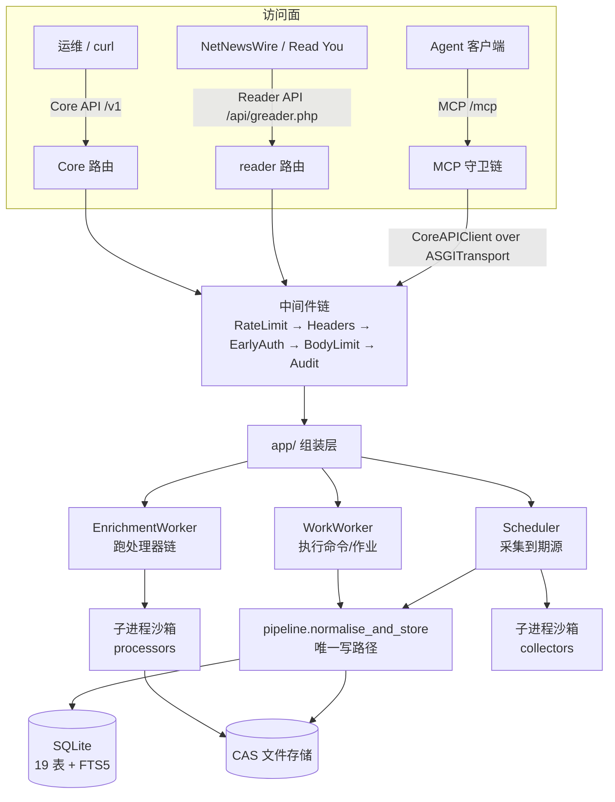
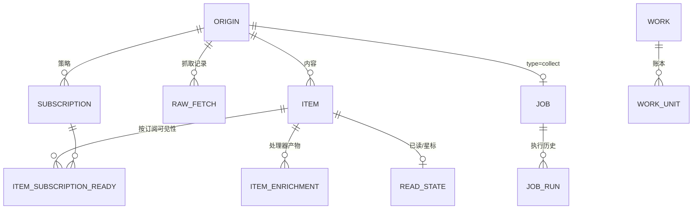
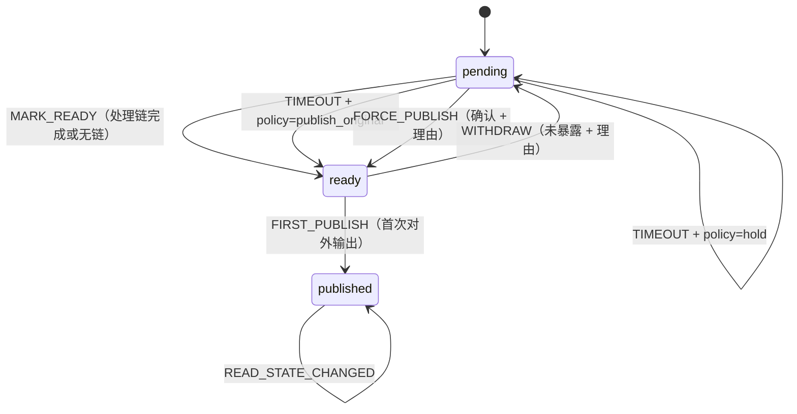
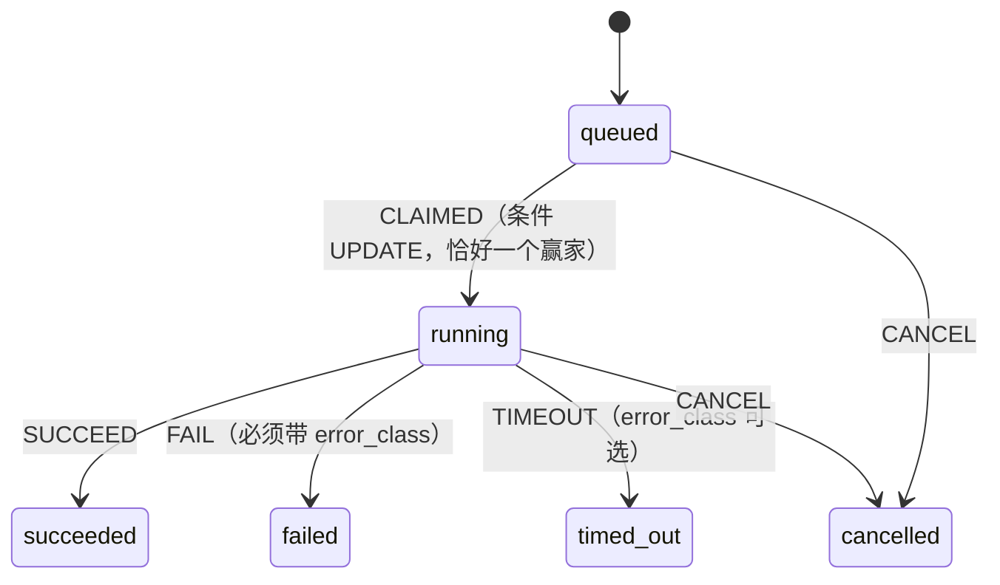
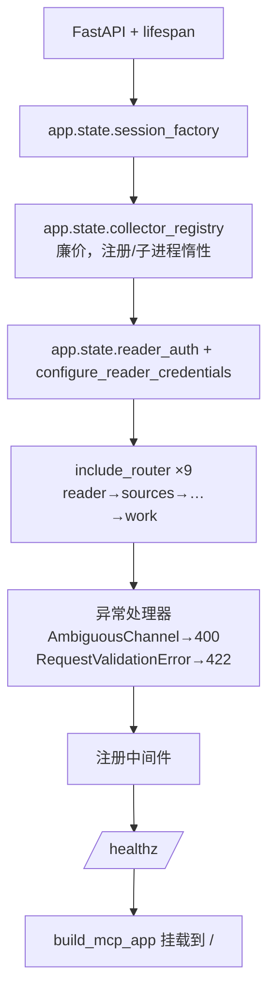
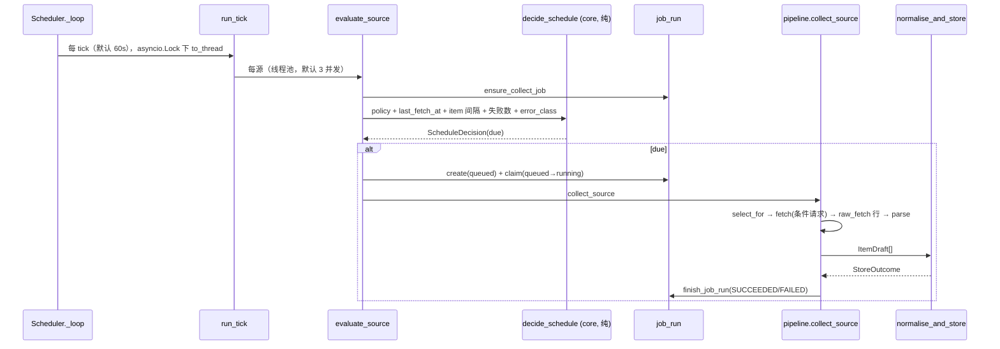
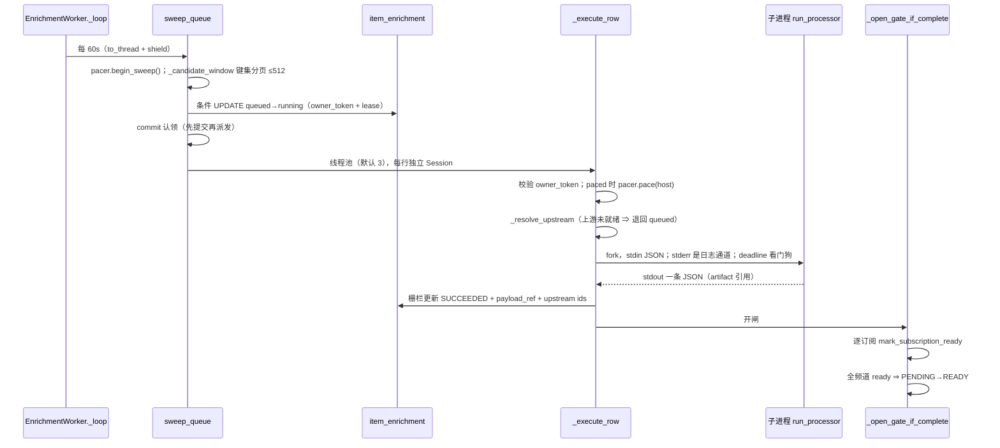
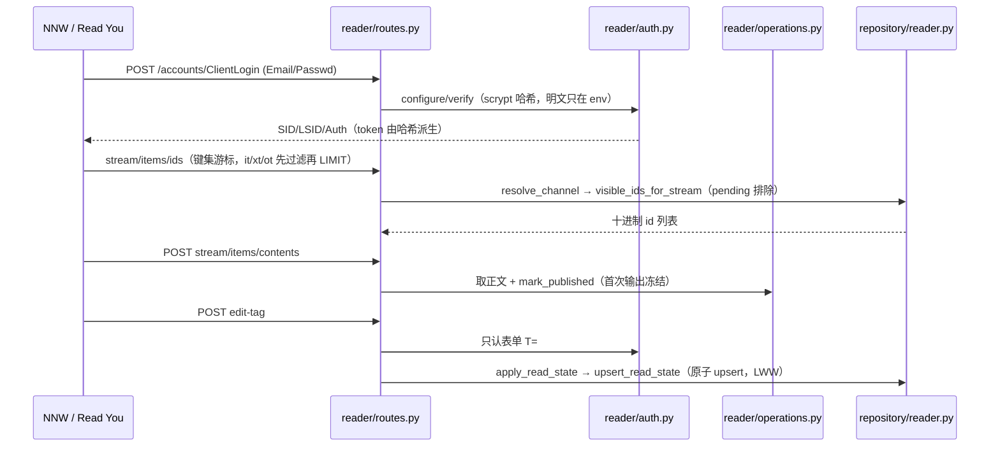
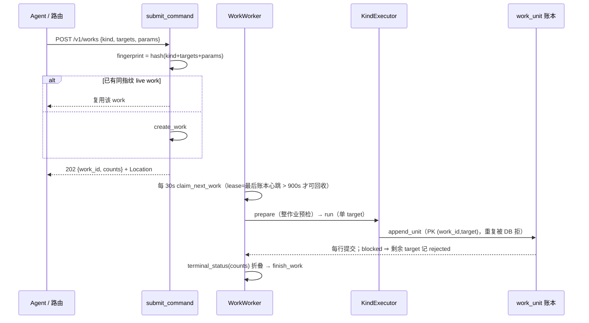
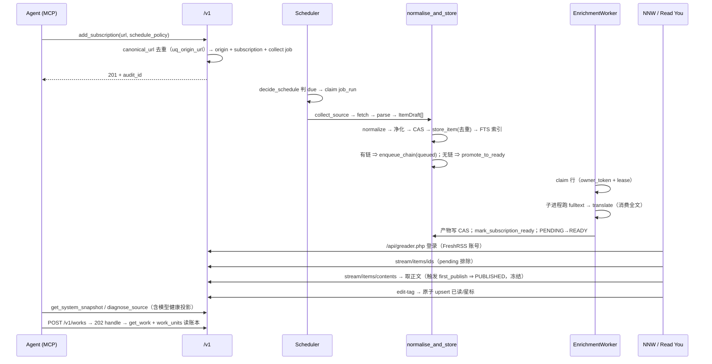

# 架构与流程总览

> **本文件解决什么问题**：`architecture-spec.md` 讲**需求与决策**（为什么这么定），
> `docs/domain/` 讲**领域语义**（不变量是什么），本文件讲**代码实际怎么跑**——
> 启动时装配了什么、四条主流程各自怎么流动、横切关注点在哪一层落下、失败了怎么恢复。
>
> 阅读方式：先看 §0 一页速览建立心智模型，再按需要跳到具体流程。
> 所有锚点形如 `file:line`，指向本仓库源码，可直接跳转核对。

---

## 0. 一页速览

### 0.1 三条收敛原则

系统中的「多」都收敛到「一」：

| 收敛 | 落点 |
|---|---|
| 所有内容入口 → 一个写路径 | `pipeline.normalise_and_store`（`src/app/pipeline.py:116`） |
| 所有对外可见性 → 一道闸门 | `core/item_state.transition` + `item_subscription_ready` |
| 所有批量/复数操作 → 一个机制 | 作业 + 账本：`work` / `work_unit`（ADR 0046） |
| 所有调用方 → 一个审计边界 | `CorrelationAndAuditMiddleware`（`src/app/middleware.py:158`） |

### 0.2 分层与数据流



### 0.3 依赖方向（CI 强制）

```
app  →  plugins  →  adapters  →  core
```

由 import-linter 单一 layers 契约强制。`src/core` **零 I/O、零框架依赖**；唯一第三方 import 是
`pluggy`（`src/core/plugins/hooks.py:30`，该模块 docstring 已论证：pluggy 自身无依赖、无 I/O）。

---

## 1. 目录地图

| 路径 | 规模 | 职责 |
|---|---|---|
| `src/core/` | 18 模块 | 纯领域：模型、状态机、normalize、去重、调度统计、错误分类、hookspec、work 折叠 |
| `src/adapters/` | — | DB/仓储(`repository/*` 20 个模块)、HTTP、RSS 输出、Reader 协议、审计、净化、脱敏、文件存储、CookieCloud、告警、embedding |
| `src/plugins/collectors/` | 5 个 | `rss`(内置) · `telegram` · `twitter` · `zhihu` · `zsxq` |
| `src/plugins/processors/` | 3 个 | `fulltext` · `translate` · `embed` |
| `src/app/` | — | 组装/DI、路由、调度器、worker、插件装载与运行时、MCP server |
| `migrations/versions/` | 0001…0029 | 线性迁移链，每步都有 `downgrade()` |
| `tests/` | unit 58 · fixture 5 · integration 96 · contract 2 · e2e 12 | 四层测试 + ~35 条结构守卫 |
| `docs/adr/` | 63 | 一决策一文件 |

`src/core` 的内部依赖只有少数几条边：
`errors→enums`、`normalize→{enums,item_state,models}`、`scheduling→{enums,models}` 等。

---

## 2. 领域模型与不变量

### 2.1 实体与外键



**事实 vs 策略已拆表**（ADR 0046）：`Origin` 是事实（`canonical_url NOT NULL`），`Subscription`
是策略（`schedule_policy` / `pipeline_chain` / `target_lang` / `folder` / `status`）。
`origin.id` 就是旧 `source.id`；`source` 表已在迁移 0028 删除，`/v1/sources*` 只剩 deprecated 投影。

### 2.2 硬不变量

| 不变量 | 实现位置 | 违反的后果 |
|---|---|---|
| 所有入口 → `ItemDraft` → `normalize` → `Item` | `src/core/normalize.py`；写路径唯一 | 去重/净化/闸门出现第二套 |
| **身份（id/guid）优先于内容**去重 | `decide_dedupe`（`normalize.py:505`） | 源改写正文时漏行 + 撞冻结 GUID |
| `content_hash` 只由 title+正文派生 | `normalize.py:257` | 同文跨源无法合并 |
| `canonical_url NOT NULL` + `uq_origin_url` | `db_models.py:102`（ADR 0008） | SQL 中 NULL 互不相等 → 唯一约束失效 |
| 时间戳定宽 `%Y-%m-%dT%H:%M:%S.%fZ` | `src/adapters/timestamps.py:27` | `.`(0x2E) < `Z`(0x5A)，混宽破坏字典序 |
| 已发布内容冻结；`pending` 一切输出不可见 | `core/item_state.py` + `visible_item_rows` | 客户端缓存无法撤回 |
| `ErrorClass` 五值 enum，DB CHECK 强制 | `core/enums.py`；`raw_fetch`/`job_run`/`work_unit` | 出现绕过 enum 的字符串 |
| `next_run_time` **不落库**，从 policy+历史推导 | `core/scheduling.py`（ADR 0009） | 两个事实源 |
| 写操作幂等：`(actor, endpoint, key)` + 指纹 | `adapters/repository/idempotency.py` | 重试产生第二份效果 |
| 复数操作 = 作业 + 账本，效果 O(1) 返回 `202` | ADR 0046 | 响应随输入规模膨胀 |
| 审计只在 Core API 中间件落地 | `src/app/middleware.py:158`（ADR 0010） | MCP 直连仓储即绕过 |

### 2.3 身份派生的确切公式

```
_digest(*parts) = sha256("\x1f".join(parts).encode()).hexdigest()[:32]

item.id   = _digest("id1", "item", tenant_id, origin_id, external_id)
item.guid = _digest("id1", "guid", tenant_id, origin_id, external_id)
content_hash = _digest("ch1", normalize_text(title).casefold(),
                              plain_text(body).casefold())
```

`"id1"` / `"ch1"` 是**方案标签**内嵌在摘要输入里：算法变更会产出新值而不是与旧值碰撞。

---

## 3. 状态机

### 3.1 Item 发布状态（`src/core/item_state.py:76`）



- `pending` 对**任何**输出不可见；`published` 后正文/guid/content_hash 冻结。
- `transition` 是 `publish_status` 的唯一写者。
- **ADR 0061 之后**：可见性不再由 `publish_status` 独立判定，而是按 `(item, subscription)`
  物化在 `item_subscription_ready`；`core/item_state.is_visible` 只余遗留调用者。

### 3.2 JobRun 状态（`src/core/job_state.py:77`）



终态集合 `{succeeded, failed, timed_out, cancelled}` 不可更改；`cancelled` 目前**无执行路径写入**（见 §12）。

### 3.3 其他

- **Work / WorkUnit**：无转移函数，终态由账本折叠派生 `core/work.py:125`。
- **ReadState**：无状态机，LWW **单语句原子 upsert**（读-改-写会与并发 edit-tag 撞 UNIQUE → 整批 500）。
- **Source/Subscription**：`active ↔ paused → disabled → active`，驱动在路由层（不在 core）。
- **Plugin**：文档写了完整生命周期，core 未实现。

---

## 4. 启动与装配

### 4.1 `create_app()`（`src/app/main.py:324`）



### 4.2 中间件执行序（`main.py:420-439`）

Starlette 反序包装，**实际执行**从外到内：

```
ServerError → AuthFailureRateLimit → SecurityHeaders → EarlyAuth(/v1)
  → BodySizeLimit → CorrelationAndAudit → Exception → router
```

半开请求头（slowloris）防御**不是中间件**，而是 uvicorn 协议类
`src/app/http_timeout.py:HeaderTimeoutProtocol`（中间件只在请求对象存在后才运行）。

### 4.3 `lifespan` 启动（`main.py:143-278`）

1. 配置日志 + 启动横幅。
2. 建**唯一一个**共享 HTTP client：
   `httpx.Client(transport=DeadlineTransport(), timeout=Timeout(connect/read/write=15, pool=60),
   follow_redirects=True, trust_env=False)` → `app.state.http_client`。
3. 显式进入 MCP 子 lifespan（挂载不会自动跑子应用 lifespan）。
4. `registry.restore_installed_plugins(...)`：从持久化审批记录 + checksum 匹配恢复第三方插件。
5. 建 `HostClientTransport(client)` 注册给沙箱采集器；`sync_plugin_table(...)` 刷新 manifest/checksum，
   **不覆盖运维的启用/禁用决定**。
6. `if scheduler_enabled():` 启动 `Scheduler` / `EnrichmentWorker` / `WorkWorker`（互相盯活）。
7. `yield`。

**关闭**：停三个循环 → 停沙箱子进程 → 关 HTTP client。

> `PRAGMA foreign_keys=ON` 是**按连接**设置的（`main.py:124`）。没有它，六个 `ON DELETE CASCADE` 全是摆设。

---

## 5. 主流程 A：调度采集

### 5.1 时序



### 5.2 到期推导（纯函数，`src/core/scheduling.py:203`）

- 观测间隔取自 **`item.published_at`**，不是 `raw_fetch`——后者记录「我们何时抓」，用它推间隔会形成
  反馈回路（抓得少 → 看到更新少 → 抓得更少）。见 ADR 0009。
- adaptive 基 = 观测间隔**中位数**，夹在 `min/max` 之间。
- 失败退避：可重试类 `2^n` 封顶 24h × ±20% 抖动；**不可重试类（blocked/auth/structure_changed）不退避**。
- 时钟回拨（`elapsed < 0`）视为 due。
- **不落库**：改 policy、退避、恢复备份三处都自动自洽。

### 5.3 抓取 → 唯一写路径

`collect_source`（`src/app/pipeline.py:279`）：

1. `registry.select_for(type, url)`——`type=="rss"` 直接取 rss；否则 installed 优先、再按内置声明顺序
   `match_url`（telegram 先于 rss）。`match_url` 是纯函数、无网络。
2. `_collect_one_page`（`pipeline.py:382`）：
   - `fetch_page_with`：`fetches=True` → 采集器自取；否则 `adapters.http.fetch`（带
     `conditional=last_conditional_state` 走 ETag/Last-Modified）。
   - `FetchError` → 记 `raw_fetch` 失败行。
   - `raw_fetch` 成功行保存 etag/last_modified 供下次条件请求；`304` 即结束本轮。
   - `registration.paged` → `collect_paged`（走 `seen_frontier` / `floor_cursor` 区间）。
   - `parse_with` → `ItemDraft[]`；`set_origin_title_if_absent`（只补空，不回填）。

`normalise_and_store`（`pipeline.py:116`）：

```
normalize(draft)                      core/normalize.py:327
  ├ canonicalize_url（限 http/https、去追踪参数、排序 query、去 fragment）
  ├ 标题缺失 → 派生；published_at naive → 贴 UTC
  └ 派生 id / guid / content_hash
sanitize_html(body)                   pipeline.py:154  ← nh3，入库前净化一次（ADR 0007）
filestore.store_body(markup)          → "cas://<sha256>"
store_item(session, item)             adapters/repository/items.py:82
  ├ find_by_identity ∪ find_by_content_hash → decide_dedupe
  └ 分支：INSERT / INSERT_RELATED / UPDATE_PENDING /
          SKIP_SAME_SOURCE / SKIP_PUBLISHED_CONTENT_CHANGED / SUPPRESS
index_item(session, item)             写 FTS5（先删后插）
subscriptions_for_origin(origin)      逐订阅各入其链（ADR 0061）
  ├ enqueue_chain(...)                → item_enrichment(queued)
  ├ mark_subscription_ready(...)      无链订阅直接物化可见
  └ 完全无 spec → promote_to_ready(item)
commit
```

**去重分支的语义**（`core/normalize.py:505`）：

| 分支 | 触发 | 动作 |
|---|---|---|
| `SKIP_SAME_SOURCE` | 身份或内容命中且同源 | 不写 |
| `SKIP_PUBLISHED_CONTENT_CHANGED` | 身份命中、正文变了、已 published | **保持不动并告警**（重写会与客户端缓存分叉） |
| `UPDATE_PENDING` | 身份命中、未发布 | 就地换正文并复位 `pending`，重排队处理链 |
| `SUPPRESS` | 内容命中、跨源、命中已冻结副本 | 只展示一次 |
| `INSERT_RELATED` | 内容命中、跨源、未冻结 | 建行并关联 |
| `INSERT` | 都没命中 | 新建 |

---

## 6. 主流程 B：处理链（富化 → 开闸）

### 6.1 时序



### 6.2 关键机制

- **认领栅栏**：`owner_token` + `lease_expires_at`；每次写入都被栅栏保护，迟到的旧 owner
  无法覆盖新 owner 的结果。
- **上游数据流**（ADR 0030）：后序 spec 消费最近一个前序**可消费**产物
  （`CONSUMABLE_KINDS = {fulltext, summary}`；`translation` 明确排除以免自我喂养）。
  产物按 `input_hash` 钉版本，记入 `upstream_plugin_id` / `upstream_digest`。
- **子进程**：每行一个 `python -m app.processor_runtime`；stdout 只走协议（子进程把插件 `print`
  重定向到 `/dev/null`）；stderr 按 `<LEVEL>` 解析后重记，加 `[plugin_id item_id]` 前缀，有界
  200 行/1000 字符；独立保留最后 3 行，子进程被击杀时附到失败 detail（ADR 0050）。
- **行预算**（ADR 0047）：一个绝对 deadline（默认 360s）同时给子进程与看门狗；`lease_expires_at`
  = now + deadline + 5s 宽限。
- **块级缓存**（ADR 0052）：`<storage>/processor-cache/<plugin>/<lang>/<item>`，成功的块原子写入；
  成功后运行时删除、失败时保留（重试只补缺失块）。
- **节奏**：`HostPacer` 只 pace `fulltext`（翻译打的是 operator 自己的 provider，按 item host
  限速会限错对象）。per-host min-interval 2s、每 sweep 上限 2、blocked 冷却 900s、
  同 host 同时一次在途。
- **失败分级**：transient（network/blocked）且 `attempts < 3` → 回 queued 加退避；否则 `FAILED`。

---

## 7. 主流程 C：发布与消费

### 7.1 发布

`READY --FIRST_PUBLISH--> PUBLISHED`，由 `mark_published` 的条件更新执行
（`WHERE publish_status='ready' AND published_to_feed_at IS NULL`，`repository/feed.py:177`）。

「输出适配器」是**复数**，三条路径都算：

1. Reader API `stream/items/contents`（`src/app/reader/operations.py:512`）——**真实客户端走这条**
2. `GET /v1/items/{id}/body`（`src/app/items_routes.py:841`）
3. RSS 渲染 `adapters/rss_out.py`——**生产已死**（ADR 0016 移除 `/feeds/*.xml`）

### 7.2 消费（Reader API）



- **认证不对称**（硬约束）：**写**端点只认表单 `T=`；**读**端点 header 与表单 `T` 皆可；
  **查询串永远不作为凭据来源**（ADR 0026）。
- **id 映射**（ADR 0006）：内部 128-bit hex → `reader_id = int(hex[:15], 16)`（60-bit 十进制）；
  `contents` 长式 id = `tag:google.com,2005:reader/item/<16 位零填充 hex>`。
- **文件夹**：`subscription.folder` 的**值**重命名（文件夹不是实体）。
- `ac=unsubscribe` → 只停采集，内容保留（ADR 0063）。

---

## 8. 主流程 D：命令 / 作业



- 六种 kind：`fetch` / `delete` / `enrich` / `retry` / `subscribe` / `ingest`。
- `counts` **不落库**，由账本折叠（`core/work.py:109/125`）。
- `rejected`（没尝试，不值得重发）与 `failed`（尝试了但失败，值得重发）必须分开。
- 读侧对称：`GET /v1/works/{id}`（状态+counts）+ `GET /v1/works/{id}/units`（逐条，按 outcome 过滤）。
- 账本是**运维记录**不是事实源：默认 30 天清理；**没有 `finished_at` 的 work 永不清理**。

---

## 9. 主流程 E：MCP 控制平面

```
Agent → POST /mcp（Streamable HTTP，2026-07-28）
  守卫链（main.py:490-499）：
    MCPPathGuard        精确匹配 /mcp，其余 404（404 不暴露端点名/env 名）
    MCPAuthMiddleware   PEARSS_MCP_TOKEN 常量时间比较；未配置 503 fail-closed
    MCPHeaderValidation Mcp-Method/Mcp-Name 与 body 不符 ⇒ 400 -32020
    mcp_inner           SDK 应用

工具调用 → CoreAPIClient.request（mcp/core_client.py:80-113）
    httpx.AsyncClient(transport=ASGITransport(app=同一个 FastAPI app))
    读：只带 Authorization（不产生审计行）
    写：Authorization + 每次新的 Idempotency-Key: mcp-<uuid4>
    → 命中 /v1 → 审计中间件写行 → 回 x-audit-id → _attributed 塞进工具结果
```

- **31 工具 = 13 读 + 18 写**；2 个 Resource：`item://{item_id}`、`ui://pearss/health`。
- **工具面是 `/v1` 的语义投影**（ADR 0036）：一个 `PATCH /v1/sources/{id}` 背后是 4 个意图化工具。
- **全部经 `/v1`**（ADR 0010）：无一工具直连仓储，审计天然覆盖。
- **写不 elicit**（ADR 0058）：靠 token scope + 描述/annotations + 每次新幂等键 + 审计行。
- 破坏性工具 = `purge_origin` / `delete_items` / `delete_origin_items`；`remove_subscription`
  刻意**不**算破坏性（它不删任何东西，ADR 0063）。
- 取正文优先 Resource；不支持 Resource 的客户端用 `get_item_body`（默认 4000、上限 20000，
  自述 `truncated` / `total_chars`）。

---

## 10. 主流程 F：插件生命周期

```
内置 shipped：_DECLARATIONS 声明 (id, sandboxed, capabilities)
  启动 _build_registry → 读 source_config() → 双向校验「声明 ↔ hookimpl」
  rss 进程内；telegram/twitter/zhihu/zsxq 是 SandboxedCollector 代理

第三方 installed：PEARSS_PLUGIN_DIR/<id>/{manifest.json, collector.py, .venv/}
  POST /v1/plugins/{id}:import
     → verify_in_child：在子进程里 import
     → 双向校验 manifest 声明 ↔ 实际 hookimpl；不一致即拒绝且不留痕
     → 确认文本列出插件请求的凭据前缀
  :enable / :disable（幂等写、全程审计）
  :reload → 杀进程重 spawn
  DELETE /v1/plugins/{id} → 卸载但**不删用户文件**
```

**沙箱**：`PluginChild` 跑 `python -m plugins.collectors <id>`；`RLIMIT_CPU=300s` /
`RLIMIT_AS=512MB`；env allowlist = 基础变量 + TLS/proxy + 该插件声明的凭据前缀；
出网经 `HostClientTransport`（SSRF/timeout/size 上限生效）；分类失败是**值**，
只有传输/框架失败才重启子进程一次；装载器**不判断插件是否安全**（ADR 0023 信任模型）。

---

## 11. 横切关注点

| 关注点 | 实现 | 要点 |
|---|---|---|
| 鉴权 | `app/auth.py` + `EarlyAuthMiddleware` | 三 token → `api:full` / `api:read-only` / `api:ingest`；常量时间；fail-closed；**body 解析前**强制 scope |
| 幂等 | `api_conventions` + `repository/idempotency.py` | 指纹 = method+path+排序 query+规范化 body；重放带 `Idempotent-Replay: true`；冲突/进行中/未知 409；窗口 7 天 |
| 审计 | `CorrelationAndAuditMiddleware` | 单 worker 线程、有界队列、fire-and-forget；只记写 + 携带凭据的 401/403；参数/头/URL 脱敏 |
| 脱敏/日志 | `redaction.py` / `log_safety.py` / `log_limits.py` | 唯一 `redact_url_for_log`（结构守卫钉死）；控制字符转义；按 key 限速 60s |
| SSRF | `adapters/http.py::_refusal_reason` | fail-closed；Tailscale CGNAT/ULA 豁免（ADR 0027）；guard 开时手动逐跳校验 + 跨 host 剥凭据 |
| 传输边界 | `DeadlineTransport` | 一个**绝对 deadline** 贯穿重定向与 body 读取；5 MiB **解码后**上限；`trust_env=False` |
| 时间戳 | `adapters/timestamps.py` | 定宽格式的唯一来源 |
| 审计边界 | Core API 中间件 | 一切调用方（含 MCP）都经它 |

---

## 12. 失败与恢复

| 场景 | 机制 |
|---|---|
| 采集失败 | `core/errors.classify` 五值归类 → `job_run.error_class` → 调度按 `allows_automatic_retry` 决定退避/常速 |
| 崩溃留 `running` job_run | 启动紧窗口（4×tick）与周期性回收 → `timed_out` |
| enrichment owner 崩溃 | lease 过期可回收；`owner_token` 栅栏挡住迟到的旧 owner |
| work 执行者崩溃 | 账本保证可续跑（跳过已写 unit 的 target）；lease 900s 后回收 |
| 处理器被击杀 | 最后 3 行 stderr 折进失败 detail；模型健康仍被记录 |
| 上游产物未就绪 | 行退回 queued，不降级、不消耗 attempt |
| 取消 | **ADR 0037 只定义未实现**：没有代码写 `CANCELLED`，被放弃的 run 一律 `TIMED_OUT` |
| 双循环同死 | ADR 0039 承认静默风险，仅 `/healthz` 被动兜底 |

---

## 13. 端到端：一次「加源 → 出内容 → 已读同步」



---

## 14. 配置面（关键开关）

```
鉴权   PEARSS_API_TOKEN / _API_READ_TOKEN / _INGEST_TOKEN / _MCP_TOKEN
Reader PEARSS_READER_USERNAME / _READER_PASSWORD（库内只存 scrypt 哈希）
调度   PEARSS_SCHEDULER_ENABLED / _TICK_SECONDS / _TICK_CONCURRENCY
处理   PEARSS_ENRICHMENT_CONCURRENCY / _WORK_LEASE_SECONDS / _WORK_RETENTION_DAYS
抓取   PEARSS_FETCH_MIN_INTERVAL / _FETCH_MAX_PER_HOST_PER_SWEEP / _FETCH_COOLDOWN_SECONDS
公网   PEARSS_DOCS_ENABLED / _MAX_BODY_BYTES / _AUTH_RATELIMIT_* / _ALLOW_PRIVATE_FETCH
采集器 PEARSS_X_AUTH_TOKEN + _X_CT0 / _ZHIHU_COOKIES / _ZSXQ_* / _COOKIECLOUD_*
处理器 PEARSS_TRANSLATE_BASE_URL / _API_KEY / _MODEL(S) / _EMBEDDING_MODEL_DIR
```

`.env.example` 是完整清单，由结构守卫**双向**强制与代码同步（代码读了模板漏的、或模板里有没人读的，
测试都会失败）。

日常命令（全部是 `justfile` 中真实存在的目标）：`just run` 本地启动；`just migrate` 建库；
`just ci` 完整门禁；`just contract` 刷新 MCP/OpenAPI 快照；`just backup` 备份。

---

## 15. 附录

### 15.1 表清单（19 表 + FTS5）

`origin` · `subscription` · `item_subscription_ready` · `raw_fetch` · `item` · `job` · `job_run` ·
`feed_out` · `read_state` · `reader_credential` · `idempotency_record` · `plugin` · `audit_log` ·
`item_enrichment` · `work` · `work_unit` · `item_fts`(FTS5) + `alembic_version`

关键唯一约束：`uq_origin_url(tenant,canonical_url,type)`、`uq_item_guid(tenant,guid)`、
`uq_enrichment_product(item,plugin,plugin_version,kind,lang,input_hash)`、
`uq_job_run_active_per_job`(partial)、`uq_work_live_fingerprint`(partial)、
PK `read_state(item_id,tenant)`、PK `work_unit(work_id,target)`、
PK `idempotency_record(actor,endpoint,key)`。

### 15.2 面清单概览

| 面 | 数量 | 备注 |
|---|---|---|
| Core API `/v1` 读 | 22 | 其中 `/v1/sources*` 一系为 deprecated 投影 |
| Core API `/v1` 写 | 27 | 全部需 `Idempotency-Key` |
| Reader API | 13 | 独立凭据，认证不对称 |
| MCP 工具 | 31（13 读 + 18 写） | 全部经 `/v1` |
| MCP Resource | 2 | `item://` · `ui://pearss/health` |
| 采集器 | 5 | 1 内置 + 4 子进程沙箱 |
| 处理器 | 3 | fulltext · translate · embed |
| Work kind | 6 | fetch · delete · enrich · retry · subscribe · ingest |
| ErrorClass | 5 | blocked > auth > network > parse > structure_changed |

### 15.3 相关文档

| 文档 | 内容 |
|---|---|
| `architecture-spec.md` | 需求、总体架构、路线图、选型与决策 |
| `AGENTS.md` | 编码 agent 的项目规则与完成标准 |
| `docs/domain/data-model.md` | 领域实体、关系、保留与备份策略 |
| `docs/domain/state-machines.md` | Item、JobRun、Plugin 等状态机 |
| `docs/domain/error-taxonomy.md` | 错误分类与诊断语义 |
| `docs/api/style-guide.md` · `docs/api/mcp-tool-guide.md` | REST / MCP 设计与演进规范 |
| `docs/guides/testing.md` | 测试层次、fixture、契约与 e2e 规则 |
| `docs/guides/host-http-boundaries.md` | HTTP 组合边界 |
| `docs/integrations/netnewswire.md` | NetNewsWire 集成与缓存约束 |
| `docs/operations/runbook.md` | 故障处理与恢复操作手册 |
| `docs/adr/0000-adr-index.md` | 全部 ADR 索引 |
